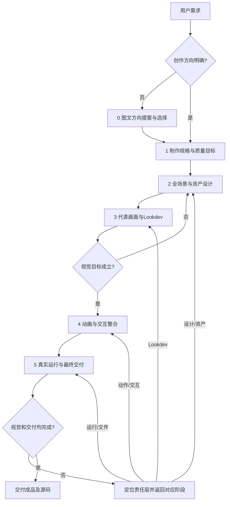

# Three.js 视觉作品制作

以用户选定的视觉效果为目标，把参考落实成可维护的资产、场景、材质、摄影和动画，再交付真实运行的作品。主链路只有一套：**选方向 → 定规格 → 设计资产与场景 → 完成代表画面 → 动画与交互 → 验证并交付**。

## 先确定任务与边界

| 当前请求 | 执行方式 |
|---|---|
| 研究案例、原理或路线 | 读已有作品、源码与一手资料，按[研究方法](references/research-methods.md)输出证据与迁移方法；新增运行实验需属于用户授权范围 |
| 验证一个机制 | 写清问题、输入、预期变化和最少证据；机制可运行不代表画质成立 |
| 制作或打磨作品 | 执行下述主链路；已有设计和通过证据可复用，先确认它们对应当前构建和目标 |

用户已明确的风格、观看方式、资产限制和交付要求进入规格，跨阶段持续继承。可自行核对的信息先核对；仅追问会改变方案且无法推断的信息。用户要求直接执行时，说明合理假设后推进。

**最终呈现由 Three.js 渲染。** 图像生成用于方向、构图、造型、多视角与部件研究；默认不把生成图放入背景平面、sprite、贴图、DOM图片或最终帧。将参考转译为几何、程序纹理、材质、shader与布局规则。用户明确授权图片进入成片时，记录其实际贡献。

**按效果选择资产路线。** 程序化几何、DCC模型、许可清楚的现成模型、AI候选经修整的3D模型均可由Three.js组装与渲染。模型随附材质/纹理按资产约束和来源许可审核，概念参考图不能直接冒充三维表面。先判断目标景别、轮廓/体积复杂度、动作和成本，再选路线；用户明确要求纯代码几何时遵守该限制。参考工程默认用于研究方法，直接复用其资产或专用源码按用户授权及许可范围执行。

## 制作主链路

制作任务先读[生产流程](references/production-workflow.md)与[统一验收](references/validation.md)。各阶段的技术参考按下方入口选读；不要求每次加载全部指南。

| 阶段 | 必须完成的工作 | 离开阶段时应有的产物 |
|---|---|---|
| **0 选方向** | 对开放式请求提出至少5个有实质差异的方向，改变叙事视角、构图、时间/天气、风格或主体关系；有生图工具时做清楚分格的图文方向板。每项说明画面、推荐理由、Three.js实现抓手、依据和取舍，请用户选择或混合；已明确方向或授权直接执行时进入阶段1 | 用户选定方向或明确执行假设；图仅作研究参考 |
| **1 定规格** | 定观众、用途、时长/画幅、焦点与可见识别特征、质量目标、事实依据、资产约束、交付形式和相机模式；把“精细/生动”转为可观察的形体、材料、空间与运动目标 | 一页制作规格、质量目标卡、来源与未知项 |
| **2 设计资产与场景** | 先构图与完整灰盒；规划焦点、支撑、环境、前中远景、光区和负形。对关键资产做所需多视角/部件参考，拆出主形、中层结构、表面信息、连接与运动规则；逐项选择几何或模型资产路线并映射到实现 | 场景组成台账、特征→实现映射、资产接口、相机包络与镜头/cue表 |
| **3 完成代表画面** | 用真实代码/资产完成最能暴露质量问题的镜头与必要侧背视角；依次完成轮廓/体积、连接/中层结构、材质与灯光、像素细节；用相同景别和画幅对照目标参考 | 当前构建的原尺寸彩图、必要灰模/局部、逐项差异结论；通过核心镜头标准后扩展 |
| **4 动画与交互** | 用绝对时间完整求值姿态、相机、显隐、FX、字幕和声音cue；共用变形后锚点与环境场。先主动作/因果反馈，再次级动作；影片与自由查看相机分别管理 | 关键事件前中后帧、连续片段、乱序seek结果、可操作的播放/相机模式 |
| **5 验证交付** | 从当前版本构建最终文件；检查连续播放、交互、声音、性能、资源和媒体属性，分别记录结果；检查用户实际打开的文件 | 最终HTML/媒体、源码和必需资产、来源/许可、构建运行说明、当前版本验收证据与未覆盖项 |

### 决定品质的前置选择

- **资产路线先证明能表达目标。** 复杂焦点资产先验证最困难的轮廓、厚度、内部/背面或变形需求。基础体可作为灰盒，也可服务明确选定的简化画风；若读成通用零件拼贴且缺少目标特征，先换几何表示或模型路线。
- **每个可见组成都有设计职责。** 场景台账覆盖主体、支撑、环境与效果，各自按目标景别完成大中小形、材料与空间关系。丰富度来自有组织的层次、尺度与因果关系；安静区域和留白也应有意图。
- **把细节分配到最终像素。** 改轮廓/厚度用几何，改材料区用颜色与粗糙度，改微受光用法线/shader；近景保留可辨结构，远景合并低于采样能力的细节。数量和噪声不能补出缺失的中层结构。
- **代表画面决定是否扩片。** 质量目标卡逐项对应当前Three.js渲染。轮廓、结构、材质或场景覆盖存在重大缺口时，修设计/表示/生成规则；用户要求成品时，内部原型不能作为最终交付。小作品减少镜头和次要资产数量，保持约定品质。

### 相机与交付模式

| 模式 | 实现与验收 |
|---|---|
| 影片或固定镜头播放页 | 导演控制相机；验证构图、连续动作、时间轴及媒体/声音 |
| 可交互3D浏览 | 默认按完整水平360°环绕规划；记录中心、俯仰、远近距离与合理限制，构建所有可达方向的物体背面、环境、透明面及光影 |
| 影片＋自由查看 | 分离导演相机与用户相机；时间轴不覆盖自由机位，返回影片可恢复确定性机位；两种模式分别验收 |

360°环绕3D场景与固定点全景图/视频是不同产品。承诺环绕时，在最终页面实际拖动一整圈并检查至少8个方位、俯仰与远近端点，保存目标视口证据。启用OrbitControls、参数声明或导出影片帧只能证明部分实现，不能证明交互和全视角内容完成。环境/工具故障导致无法操作时，标为交互未验收。

### 返工与完成判断

按“目标特征 → 资产/代码 → 当前视口或时间 → 差异与根因 → 修复结果”保留轻量记录。先修最影响目标的责任层；连续两轮同类改动无可见改善时，重查设计、表示或空间/时间关系。视觉、连续动作、交互、声音和性能分别验收，脚本PASS不代替审图。标准及证据范围以[验收](references/validation.md)为准。

## 按问题读取方法

| 当前工作 | 参考的唯一职责 |
|---|---|
| 从需求到交付、阶段产物、职责交接 | [生产流程](references/production-workflow.md) |
| 参考图转规格、形体/材料设计、资产路线与空间布局 | [资产设计](references/asset-craft.md) |
| 编写几何、生成器、程序材质/FX与基础时间函数 | [Three.js代码方法](references/threejs-code-sop.md)，按目录读取对应章节 |
| 渲染后端、PBR/IBL、色彩、反射/透射与渐进导出 | [渲染选择](references/rendering-choices.md) |
| 自定义MRT、描线、深度雾与多遍数据 | [渲染契约](references/render-contracts.md)，仅相应管线使用 |
| glTF/骨骼、IK、历史模拟、GPU状态、实例/BVH与性能 | [动画与场景规模](references/motion-and-scale.md) |
| 图像/3D/声音生成服务接入 | [AI资产管线](references/ai-asset-pipeline.md)，实施时核对当前工具、成本与API |
| 视觉、相机、运行与最终文件检查 | [统一验收](references/validation.md) |
| 研究参考片、逐帧分析与迁移证据 | [研究方法](references/research-methods.md) |

历史案例和具体参数保存在`docs/research`，普通制作不依赖它们。修改或发布本Skill时读取[维护约定](AGENTS.md)。
