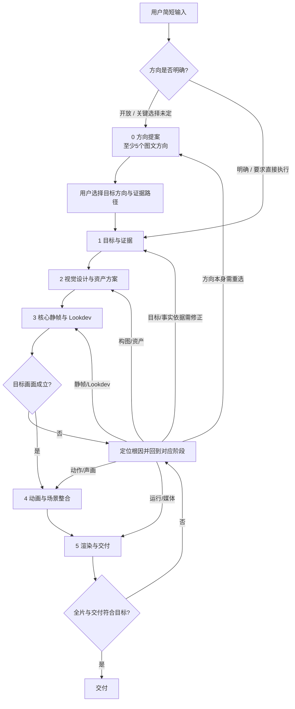

# Three.js 动画成片制作

把设计意图落实成代码生成的几何、材质、动作、摄影与可靠交付。学习参考的生成机制和生产流程，为新题材独立完成设计与实现；质量由结构、表演、光影、构图及时间稳定性共同判断。

**默认代码交付边界：**图像生成模型产出的画面用于构图、色彩、造型和部件研究，不是最终渲染素材。将参考提炼为结构/比例/颜色/光线规则，再用 Three.js 几何、实例化对象、程序化 CanvasTexture 或 shader 实现；不得把参考图直接放进背景平面、精灵、贴图、DOM 图片、视频帧或最终合成。用户明确要求成片使用图像素材时，才按该授权改变这条默认规则，并说明哪些画面由图片而非 Three.js 场景生成。

## 任务模式与参考边界

从会话确认题材、时长、画风、目标景别、播放场景、输出形式、资产和成本约束。已有明确制作授权时推进，不重复索取确认；仅询问会改变方案且不能自行核对的信息。默认产物是可重建的Three.js代码渲染；需要图像参考时，图像只参与设计，不作为运行时画面素材。

| 用户目的 | 当前动作与边界 |
|---|---|
| 学习原理、优秀案例、流程或选择路线 | 阅读已有作品、帧、源码和一手记录，输出机制与路线；不新建试片、不改产品代码、不启动试渲染。“继续”继承研究模式 |
| 明确验证某个机制 | 先定义问题、输入、预期结果与最少证据，只执行获准范围；机制通过不代表画质或迁移通过 |
| 制作/打磨作品，包括明确要求的demo | 明确完成标准后执行设计、资产、镜头与交付；不能用无目标的整镜反复渲染代替前置设计 |

默认把参考仓库作为研究材料，不把它的角色/场景资产、成片或专用模型/材质/引擎源码直接搬进新作品。提炼结构生成方法、数据契约和制作顺序，再为新对象实现；成品应在移除研究副本后仍能构建和运行。Three.js及通用依赖可正常使用。用户明确要求代码复用、资产改编或指定外部资产时按其范围执行，说明来源、许可和实际原创范围；学习流程的请求不等于这种授权。

区分“大语言模型/Agent”（理解要求、编写程序）和“三维模型”（网格及其属性）。自然语言与参考→结构规格→生成/更新程序→运行时几何/姿态/材质数据→渲染，是需要落实的链路；文字更长、顶点更多或参数更精确均不自动提高品质。概括设计意图时标为解释，不冒充作者原始提示词。

## 制作主流程：方向选择到交付

制作任务先判断用户输入是否已明确创作方向，再进入五个制作阶段。开放式或关键视觉决策未定的请求，先经过“方向提案与选择”；用户已给出明确方向或要求直接执行时，不重复提问，可以只对仍开放且会显著改变成片的维度提出候选，或说明可推断的假设后继续。方向提案阶段完成用户选择后，阶段1再把选择转成目标与证据规格。任何制作任务在焦点资产编码前都必须完成[Three.js代码化制作SOP](references/threejs-code-sop.md)的“质量预排”：锁定目标相机下的轮廓/负形和像素占幅，把结构、连接、材质、实例预算映射到具体生成函数与参数，并写明几何/实例数量、锚点、末端覆盖和目标视口检查。生成计划与实际数量不符时必须显式报错，不能静默截断。代理几何仅用于构图，不能作为通过资产质量门的成品；代表画面必须验证剪影、中层结构、接地/连接、受光和目标像素尺度。后文 1–5 节细化目标与证据、视觉设计与资产、核心静帧、动画整合与返修、渲染交付。任何制作或打磨任务都必须先阅读[Three.js代码化制作SOP](references/threejs-code-sop.md)，再进入资产实现；其他参考文档按具体技术问题选读。小作品可以减少镜头、资产和细节数量，不跳过方向决策、视觉设计与代表画面。

| 阶段 | 原子步骤 | 阶段产物 |
|---|---|---|
| **0. 需求澄清与方向提案** | 先读懂用户已给出的题材、用途、风格和限制，只追问会改变成片且无法从上下文推断的关键信息；对开放式请求至少发散 5 个彼此可辨认的创作方向，方向之间改变叙事视角、时间/天气、构图/景别、风格或主体关系等有意义的设计变量，而不是只换配色/滤镜 → 用图像生成工具做一张清楚分格的方向板（至少 5 格，图仅供视觉研究）并给每格配简短文字：方向概念、观众看到/感到什么、推荐理由、Three.js实现抓手、事实依据/风格参考路径、主要取舍 → 将方向板和文字一起展示，请用户选择或混合方向；根据选择记录目标和证据路径，再进入阶段1。用户已经明确指定方向或要求直接执行时，尊重指令，不强制制造多余选择；只补齐真正未定且影响显著的决策 | 用户可比较的至少 5 个图文方向、推荐理由与取舍、待选的目标和证据路径、用户选定项 |
| **1. 目标和证据** | 依据用户选定方向（或明确指令）确定题材/情绪/观众注意点 → 选 2–4 个可见识别点 → 确定画幅、景别、时长、播放方式和成本 → 区分事实参考与风格参考 → 核对会影响轮廓、尺度、位置、连接和遮挡的事实；没来源的选择标为设计设定 → 把方向描述变成能在构图、静帧和时间线上检查的质量标准 | 一页制作规格、参考及来源、质量目标卡（焦点/识别点/构图/光色/动作/参考依据） |
| **2. 视觉设计与资产方案** | 做小构图稿 → 定地平线、视觉重心、主体占比、前中远层次、留白和主光 → 从阶段0选定方向出发，必要时用图像生成细化构图/色彩/资产视角参考，固定其“仅供参考”身份 → 记录焦点/支撑/背景对象的轮廓、负形、结构关系、材料、动态、目标像素与验收帧 → 把每项可见特征映射到 Geometry/材质/Shader/实例生成函数，定义父子锚点、接触关系、随机种子、LOD、精确实例预算和运行时不变量 → 以目标相机做剪影与构图预排 | 视觉参考、可执行的场景/资产规格、视觉细节规格表、代码表示映射、实例预算与不变量、目标机位预排 |
| **3. 核心静帧与 Lookdev** | 代理几何只搭布局 → 锁定目标机位与尺度 → 按预排实现完整焦点资产：主形与结构、连接与遮挡、材质/UV/受光、次级细节 → 在目标分辨率渲染灰模剪影、彩图、原尺寸与局部裁切 → 按规格检查轮廓覆盖、计划/实际实例数、端点/接触、像素可读性和明暗层级；差异必须定位到参数、几何或材质生成层，修正后用相同相机/种子复核，资产通过后才进入动画扩片 | 完全由当前 Three.js 场景代码渲染的代表画面、可重建资产、生成参数和通过记录 |
| **4. 动画与场景整合** | 将镜头拆成建立/行动或变化/收束等必要节拍 → 给事件标绝对时间和主体锚点 → 让姿态、镜头、材质、FX、字幕、声音都由同一时间状态完整求值 → 加入与主体运动相因果的环境反馈 → 检查关键事件前/中/后及随机 seek → 只把已成立的资产和画面规则扩展到全片 | 完整镜头/场景、时间轴、环境反馈和声画 cue |
| **5. 渲染与交付** | 固定目标视口/帧率/运行入口 → 构建离线 HTML 或导出媒体 → 实际打开并检查关键画面与连续动作 → 检查播放/暂停/拖动/重播及结尾 → 核对时长、帧数、声音、性能和资源 → 报告已验证内容与未覆盖边界 | 用户可打开的成品、源码/资产来源、验证记录 |

参数没给齐时先用上下文和交付场景推断，不因可自行决定的画风、镜头或时长停工；简短说明选定的方向。上下文仍无法确定且不同选项会改变成品形态时再询问。完全没有长度要求的单镜视觉短景，默认做一个约 5–8 秒的完整镜头；目标平台没有指定时，默认 16:9、24 fps，Three.js 场景交付自包含 HTML。叙事确实需要多个事件时再延长，不为凑时长加空镜。

质量目标卡在阶段1形成，阶段3拿来设计和对照：

| 项 | 记录什么 |
|---|---|
| 视觉焦点与识别点 | 观众首先看什么；哪些形状/动作能辨认主体 |
| 构图与尺度 | 景别、主体占比、空间层次、关键尺度参照 |
| 画面风格 | 主色、主光、材料区别、细节密度 |
| 动作意图 | 核心节拍、方向、接触或环境响应 |
| 依据 | 参考来源、可核实事实、风格化假设 |

### 图像生成作为视觉设计工具

图像生成用于把设计假设变成可比较的构图、色彩和造型参考，不代替资产建模或真实尺寸资料，也不直接进入最终渲染。按以下方式使用：

1. 用同一质量目标卡生成少量构图/风格候选；一次只改变机位、色调或画风中的一个变量，选出满足目标的主视觉。
2. 固定主视觉后，把它作为后续编辑的参考图，明确要求保持主体比例、主要识别特征、材料分区和色彩规则，再生成正/侧/背/三分之四等所需视角。
3. 对关键资产单独生成细节图或拆解图，要求展示连接、厚度、活动部位和材质边界；动画资产按主要镜头和关节活动范围补充关键姿势图。文字标注、尺寸和精确工程关系用文本规格另行核对。
4. 对多视角结果并排检查轮廓、比例、部件数量和连接位置。视图漂移时回到主参考图重新编辑；不要把各自独立生成的角度直接拼成一个被当作精确结构的设计表。
5. 把选定图转成明确的场景/几何规格：主要截面/轮廓、比例、组件层级、连接点、材质区、主光方向和需运动部位；逐项说明由哪段 Three.js 代码和运行时对象实现，再在目标机位验证。

图像模型的连续编辑有助于保持设计方向，但不同视角和重复部件仍可能不一致。生成图是创作参考，不得直接作为影片的背景平面、sprite、材质贴图、DOM图片或最终帧；需要精确结构时，以可靠实物资料、尺寸图、CAD或人工确认的几何规格为准。开始制作前阅读[Three.js代码化制作SOP](references/threejs-code-sop.md)，它说明如何把参考转成模型、环境、材质、动画与FX代码。

### 高品质资产与场景的生成方法

- **先做识别性主资产，再补背景密度。** 主角和承担画面焦点的关键资产先按参考设计专属剪影、比例、结构分段、连接方式、材料区与受光特征；主形决定身份，中层结构解释构造，小细节最后加入。背景才适合用受控的生成器或实例化。
- **让生成器编码对象规律。** 先选少数形态家族和结构模块，再规定尺寸/比例/间距/层数/材料的允许范围、组合权重和排布规则；固定种子，在最终机位看轮廓和重复节奏。不要用同一基础体大量复制后仅随机改尺度来冒充设计。
- **按镜头选择几何表示，不用参考图代替场景。** 纯 Three.js 3D 适合可转向、近景、强视差或明显遮挡对象；代码化 2.5D 可用分层几何卡片、正交布局和程序化材质保留深度关系。背景固定也须由几何、颜色、程序化纹理或shader在 Three.js 中绘制；生成的视觉参考不直接充当图像平面。只有用户明确要求使用图像素材时，才把图片作为成片资源。
- **把环境反馈绑定到空间与事件。** 水、雾、烟、光斑、尘埃和反射各自说明形体尺度、运动方向、来源、锚点及与材质的关系；长/中/小尺度分层，高频细节按视距和像素覆盖减弱。一个重复图案或后期效果不能替代环境的整体结构。
- **小尺寸先验，最终尺寸复核。** 构图稿看主次，灰模剪影看形体，最终材质静帧看光色和层次，连续片段看运动；每个检查回答不同问题，不能互相代替。

## 按问题读取参考

| 当前任务 | 参考与职责 |
|---|---|
| 原理、优秀案例、流程研究 | [研究方法](references/research-methods.md)：证据与迁移条件；[逐帧机制研究](references/frame-mechanism-study.md)：镜头贡献与掌握程度 |
| 文字要求落成模型、结构或质感 | [资产设计与生成](references/asset-craft.md)：结构规格、表示选择、大中小形与材质 |
| 任何制作/打磨Three.js作品 | 必读[Three.js代码化制作SOP](references/threejs-code-sop.md)：模型、场景、材质、动画、FX的表示选择、代码构建和逐层验收 |
| 从零制作、阶段依赖或职责协作 | [生产流程](references/production-workflow.md)：阶段交付、契约、文件归属与集成 |
| 动作、时间、镜头、声音组织 | [制作技术](references/production.md) |
| 渲染后端、PBR/IBL、色彩与异步收敛 | [渲染路线](references/rendering-choices.md) |
| 参数曲面、IK、脊柱、环境体积和反馈 | [程序化制作机制](references/procedural-systems.md)：结构与生成器 |
| 自定义描线/绘画、多遍与深度合成 | [渲染契约](references/render-contracts.md)：数据格式、绑定和消费者 |
| 外部资产加载、骨骼、GPU状态与规模 | [动画和场景规模](references/motion-and-scale.md) |
| 图像/3D/声音生成服务 | [AI资产管线](references/ai-asset-pipeline.md)：可选工具、成本与资产验收 |
| 视觉门槛、运行证据与交付检查 | [验收](references/validation.md)：统一标准与辅助脚本 |

这些文档按问题选读，不要求每次加载全部内容。历史案例与来源存放在发布仓库的研究档案，普通制作不依赖档案、原仓库或特定角色。

## 0. 澄清需求并提出可选择的创作方向

用户给出开放式创作请求时，不要直接把模糊空间全部替用户决定后开工。先从输入中提取已确定项与开放项：题材/对象、用途和观众、期望情绪、明确的风格或参考、时长/画幅/交付、制作约束。只对会改变成片且无法通过上下文、现有素材或可靠资料推断的事项澄清；可合理推断的规格先作为显式假设，不用问卷打断创作。

对仍有实质创作空间的开放式请求，提出不少于 5 个有明显差异的方向。方向应来自不同的导演/设计选择，例如叙事视角、时段与天气、景别/机位、视觉风格、主体与环境关系、动作事件；每个方向至少改变一个能影响镜头、模型或动画实现的核心决定。不要将五种轻微色调变化、五个提示词改写或同一画面的滤镜版本当作五个方向。用户已明确风格、镜头和目标，或明确要求直接执行时，遵循已给方向；如仍有重要自由度，候选仅围绕该自由度展开，不重复质疑已确定项。

把候选制作成便于比较的“方向提案”：
- 使用图像生成工具产出一张清晰的多格方向板，至少 5 个独立画格；统一题材和画幅以便比较，每格呈现一个方向的关键构图、色彩、光线和主体关系。画面内少放文字，方向编号与解释放在随图说明中；若模型把多个方向混成相似画面或分格不清，就按方向分别生成视觉图，再用编号并排呈现，不以文字标签或换色冒充视觉差异。
- 每个编号同时写：方向名称；画面/情绪描述；为何推荐及它如何服务用户输入；关键构图或时间变化；Three.js代码实现抓手（几何/场景/材质/动画中的关键挑战）；事实核对方向与风格参考方向；代价或风险。
- 至少给一个明确推荐并解释依据，同时保留其他方向的真实差异，不能把用户诱导到唯一答案。
- 邀请用户选择一个方向、组合若干方向，或指出要调整的维度。问题应聚焦选项，不重复索取已经提供的信息。阶段0没有选定目标方向时，不锁定最终设计、不进入资产细化和影片制作；用户明确授权直接执行属于已选定方向。

方向板是纯设计参考：只用于方向比较，不进入Three.js运行时或最终影片。用户选择后，把选中图像当作视觉参考，再在阶段1明确目标、识别点、质量标准与依据。区分风格灵感和可核实事实；方向图不能证明地标位置、建筑尺寸、结构连接或历史信息。事实方向应指向可核查地图、官方资料、照片或工程图；风格方向说明参考图/色彩/光线偏好及其仅作为创作参考的属性。拿不准的地理或结构细节标成待核实或设计假设。

方向提案交付格式：先展示方向板，再按编号给出精简对照表（方向 / 核心画面 / 推荐理由 / Three.js实现抓手 / 证据路径 / 主要取舍），最后用一个简短选择问题收口。选择完成后进入“1. 定义设计输入和完成标准”；不在方向板阶段做几何编码或最终渲染。

## 1. 定义设计输入和完成标准

先确定本片要讲的事件与质量目标，并按上文“制作主流程”产出可见的构图、形体和光色依据。按规模留简短制作规格：主体身份/比例/结构依据，构图与尺度参照，色彩/主光/材料，动作节拍与接触，时长/帧率/视口/运行方式。关键构图稿、结构草图或参考能解决设计问题时先完成，不把未确定的主体轮廓带入细化。小demo缩小镜头和资产数量，不降低代表画面的品质目标。

有参考时记录版本、来源、许可、实际观察范围；以“目标效果→输入→生成器→消费者→失效条件→可见证据”解释机制。作者复盘、源码事实、运行结果、迁移建议分别标注；缺失的中间过程不补写。可参考的方法和新设计的决定分开记录。

明确本片要证明的能力。原创造型、表演、渲染或整合分别判断；参考资产换背景只证明对应改编/整合，不能宣称已迁移原创建模能力。目标过难时缩小题材/动作/镜头范围，保持约定品质，不擅自用旧主角替代。

## 2. 将设计落实为资产和镜头契约

按 [资产设计与生成](references/asset-craft.md) 将比例、体块、连接、厚度、局部结构、材料分区和变形需求映射到生成函数/资产操作。主角与关键资产使用可解释其身份的独立结构设计；背景生成器明确尺寸范围、轮廓族、结构节奏、材料分布和变化边界。先主形与连续结构，再按目标像素分配中层和微细节；每项细节说明几何、颜色、法线或光响应谁负责。数字只有被正确的规则与消费者使用才形成效果。

为每镜定义时间、事件、注意点、机位/FOV、主姿势、表情、环境反馈和声音；有字幕时规定安全区。让接触、支撑和主体可见。这一阶段交付镜头表、相机/主体锚点、资产接口和视觉规则，最终静帧在下一阶段落实。

采用协作时按 [职责与集成](references/production-workflow.md#按职责组织制作与集成) 明确导演、文件所有权、上游就绪条件、输出接口和检查范围。职责可以顺序承担；启动多Agent遵循当前用户授权和工具规则。

## 3. 完成一个代表最终品质的镜头

资产和布局已具备所需输入后，先完成最能代表目标能力的一镜：

1. **锁机位和占幅**：在目标画幅中用代理体验证相机、主体大小、空间层次、视线落点和安全范围。
2. **落实关键形体**：按阶段2的资产规格创建主体与环境的大形、连接和中层结构；只保留不承担身份、焦点或近景读形的简化背景资产。
3. **完成 Lookdev**：在最终机位加入主光、填充/环境光、材质和必要渲染效果；每种材料要有不同且可读的受光反应，后期不能代替结构。
4. **输出目标静帧**：按最终分辨率渲染彩色帧，并生成/观察灰度缩略图与主体剪影；对照阶段1的质量目标卡和阶段2的选定视觉参考，记录哪些形体、光色或构图仍不一致。
5. **按根因迭代**：先改最影响焦点的设计、资产、相机、灯光或材质问题，再重复目标视口渲染；问题在构图/造型定义时回阶段2，属于实现时修当前层。

代表画面能兑现视觉目标后，再按[核心镜头门槛](references/validation.md#核心镜头放行标准)复核并把这套资产与渲染规则扩展到全片；用户只要5秒时，这一镜就是完整交付，不另造无关试片。

按角色结构选择分件/IK、连续蒙皮/修形或长体脊柱。真实人物用来源清楚的正侧面依据校准身份和比例；机械分件或长体生物的方法不能自动替代人体软组织方案。手、道具、支撑和FX共享变形后世界锚点，检查接触前中后；包围球数字通过不等于可见表面接触。

主时钟连续，姿态、显隐、材质、FX和标题从绝对时间完整求值；需要抽帧画风才分层配置采样率，不推迟接触cue。物理/累计效果按 [状态重建](references/motion-and-scale.md) 和 [异步导出](references/rendering-choices.md) 处理，不以time uniform代替历史重建。

## 4. 动画、场景整合与有依据地细化

从已成立的核心静帧出发安排镜头变化，不通过大幅改机位或新增效果掩盖主体/构图问题。动作型与环境型镜头都沿下面顺序把视觉目标变为可求值的时间状态：

1. **写清每镜的变化。** 将时长分成必要的建立、行动/环境变化和收束节拍；为每段写观众注意点、焦点位置和画面变化。静态景物也要有明确变化来源，例如相机移动、光线变化或环境运动，不为了填满时间加无因运动。
2. **设计关键姿势与轨迹。** 先定事件前、发生时、完成后的关键状态，再连成轨迹；检查方向、速度、停顿、重心和镜头构图。动作由角色完成时先验证支撑、关节和主动作，再加次级摆动。
3. **确定锚点与接触。** 手、脚、道具、角色、粒子或尾流等共用世界空间锚点；接触/碰撞检查变形后的实际表面，并查看接触前、接触中、分离后的连续画面。
4. **实现绝对时间求值。** 用`stateAt(t)`/`renderAt(t)`从绝对时间完整设置相机、姿态、显隐、材质、FX和字幕；每次求值先写完整基准状态，不能依赖上一帧残留。累计物理、粒子或渐进渲染单独处理状态重建。
5. **接入环境与声音反馈。** FX、光色、场景反应和音效由同一事件 cue 驱动；每个反馈说明来源、方向、世界锚点、持续时间和消退方式，避免装饰性地覆盖画面。
6. **检查连续性与镜头节奏。** 对每个重要 cue 取发生前、发生时和发生后帧；快速接触在事件附近加密取样，缓慢环境变化至少看起始/中段/结束并检查一次随机时间。随后检查连续播放和任意时间跳转；处理穿插、突变、闪烁、拖影和屏幕空间过密。
7. **最后补次级细节。** 主动作、构图和环境反馈成立后，才加入次级动作、表面动态和颗粒；细节按目标视口像素尺度控制，背景始终为焦点让位。

先定位缺口在设计、结构/拓扑、变形/接触、材质、镜头/光色、渲染协议还是运行。一次修改对应一个可判读的问题，固定其他条件，复核受影响帧/动作；连续两次同类纠偏仍失败时重查表示和前置设计，停止同层调参。

按 [验收](references/validation.md) 组合原尺寸关键帧、接触表和连续片段；视觉判断不能被指标替代。阶段合并、共享规则改动和最终交付再检查全片，不为每个局部修改无条件重导完整影片。泛光、噪声、雾和文字不能遮掉结构或动作问题。

镜头、表演、环境和声音共用cue；材质区分对象，光照揭示体积，细节在目标像素尺度稳定。按目标画风建立材质与渲染契约，使用Three.js不等于拥有相同画风或自定义后期；shader/缓冲输出与消费者都需连通。

## 5. 播放与真实交付

交付前先确定用户实际拿到的格式：离线HTML、MP4、源码工程或组合；说明实时3D页面与预渲染视频的差异。然后按顺序完成：

1. **冻结本次输入。** 记录源码/资产版本、总时长、帧率、目标分辨率、渲染入口和声音状态；逐帧导出统一调用完整的`renderAt(t)`。异步渲染按其收敛机制等待，不能套用同步截图流程。
2. **生成最终文件。** 只从本次源码与资产构建；离线HTML检查所有依赖是否随包提供，媒体导出核对输出帧数与时间范围。需要时使用 [render_film.mjs](scripts/render_film.mjs)，其协议、错误门禁和限制见[验收](references/validation.md)。
3. **检查用户将打开的那个文件。** 看开场、关键事件、结尾及连续播放；HTML实际操作播放、暂停、继续、拖动、重播和结尾状态；MP4播放实际文件并检查关键帧与声音。生成帧、成功构建或旧预览均不能替代当前交付物的播放。
4. **核对文件属性和运行成本。** HTML核对资源可用性、页面错误、目标设备上的流畅度；MP4核对时长、分辨率、帧率、帧数和音轨；有声音时审听最终混音。按实际覆盖范围记录结果。
5. **整理交付说明。** 给出文件路径、打开方式、原创/外部资产来源、已验证能力和未覆盖边界；交付源码工程时补充依赖版本、构建/运行命令、入口和运行环境要求。视觉、连续动作、交互、声音和性能分开写清。

播放器证据使用当前允许的CUA/MCP。若运行环境不允许打开目标页面或文件，具体标出哪些交互/视觉检查未做，不能以渲染帧或构建结果冒充完成。构建和媒体属性校验不能证明画面品质；视觉结论必须基于当前成品的真实画面。

维护此skill及同步发布时读取 [维护约定](AGENTS.md)；普通影片制作不触发skill发布。
